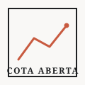

# Cota Aberta



[](https://github.com/arthurMPBBY/cota-aberta/actions/workflows/ci.yml)


**Não basta mostrar uma curva. É preciso explicar de onde ela veio.**

Analisador de fundos em **Python + SQLite + Streamlit**. Pesquisa por CNPJ e subclasse,
calcula a rentabilidade e mostra patrimônio, captações, resgates e cotistas — com os limites
do dado à vista. Projeto de portfólio em engenharia e análise de dados, não recomendação.

> O modo inicial usa dados **sintéticos**, identificados na interface. Nenhum resultado da
> demonstração representa um fundo real.

## Executar

Requer Python 3.11+. Execute na raiz deste projeto:

```bash
python -m venv .venv
```

Ative no PowerShell com `.venv\Scripts\Activate.ps1`, ou no Linux/macOS com
`source .venv/bin/activate`. Depois:

```bash
python -m pip install -e ".[dev]"
python -m streamlit run app.py
```

Abra o endereço local informado pelo Streamlit. A demonstração funciona sem internet,
conta ou banco externo. Com uv: `uv sync --extra dev` e `uv run streamlit run app.py`.

## Entregas da versão

- Seleção de fundo/classe e subclasse por CNPJ e intervalo de datas.
- Rentabilidade com as cotas e as datas efetivamente usadas, sem caixa-preta.
- Patrimônio e cotistas no último informe; somas de captações e resgates.
- Gráficos de cota normalizada, patrimônio e fluxos, com exportação CSV.
- Diagnóstico de lacunas, cotas inválidas e somas parciais; ausência não vira zero.
- Importação mensal da CVM e CSV local, persistência SQL e origem do arquivo.
- Testes unitários, AppTest e CI para GitHub Actions.

## Dados reais

Na barra lateral, selecione **Dados CVM** e importe um mês. Também funciona pelo terminal:

```bash
python -m cota_aberta.cli import-cvm --month 2026-09 --db data/funds.sqlite
python -m cota_aberta.cli import-cvm --month 2026-09 --db data/funds.sqlite --refresh
python -m cota_aberta.cli import-csv caminho/inf_diario_fi_202609.csv --month 2026-09 --db data/funds.sqlite
```

Setembro de 2026 é apenas um exemplo fixo de mês encerrado. Importe meses adicionais para
construir histórico. Os ZIPs ficam em `data/raw/`; bancos reais e demo são separados.

**Atenção:** cada CSV é um snapshot mensal. Reimportar um mês substitui o snapshot
correspondente; não envie um arquivo filtrado esperando apenas anexar suas linhas.
Consulte o relatório de importação para interpretar a cobertura. Use `--refresh` para
buscar reapresentações. Falhas não significam ausência de movimentação nem provocam
troca silenciosa para dados demonstrativos.

O Informe Diário não fornece nomes comerciais. Esta versão pesquisa por **CNPJ + subclasse**,
sem inventar nomes ou classificações comerciais.

## O cálculo

```text
rentabilidade (%) = (cota final / cota inicial - 1) × 100
índice base 100   = cota do dia / cota inicial × 100
fluxo líquido    = soma das captações - soma dos resgates
```

Exemplo: `100 → 110 → 99` resulta em **−1%**, não na soma dos retornos diários.
São necessários dois dias distintos com cotas válidas positivas. Usam-se extremos
disponíveis **dentro** do intervalo, sem buscar uma cota anterior silenciosamente.
Assim, selecionar um mês não significa calcular o retorno convencional de fechamento do
mês anterior a fechamento do mês atual. As datas efetivas aparecem junto do resultado.

Fluxos incluem todos os informes no intervalo solicitado, ambas as datas inclusivas;
podem diferir das datas válidas da rentabilidade. Somas incompletas são sinalizadas.
Patrimônio não é rentabilidade: também muda com entradas, saídas e outros eventos.

Mais em [Metodologia](docs/metodologia.md) e [Arquitetura](docs/arquitetura.md).
Consultas SQL exploratórias estão em [sql/explorar.sql](sql/explorar.sql); os totais
reportados devem ser lidos junto das contagens de campos presentes.

## Fonte e limites

- [CVM · Informe Diário](https://dados.cvm.gov.br/dataset/fi-doc-inf_diario)
- [Dicionário dos campos](https://dados.cvm.gov.br/dados/FI/DOC/INF_DIARIO/META/meta_inf_diario_fi.txt)
- [Arquivos mensais](https://dados.cvm.gov.br/dados/FI/DOC/INF_DIARIO/DADOS/)

O catálogo informa os últimos doze meses na coleção principal, além de históricos
separados. O MVP automatiza a coleção mensal, não o histórico completo desde 2000.
Há reapresentações e atrasos. Data de importação não é data de competência nem garantia
de atualidade. Ausência em dias de semana é um alerta **sem calendário de feriados**,
não prova de atraso regulatório.

Não há interpolação, CDI, ranking, cálculo de imposto ou retorno personalizado. Amortizações
e distribuições podem exigir ajustes: variação da cota não garante retorno total ajustado.
Código sob MIT; dados mantêm condições da CVM (o catálogo indica ODbL).

## Desenvolvimento

```bash
python -m pytest -q
ruff check .
```

A suíte é offline. A integração real é separada, sujeita a disponibilidade e tamanho dos
arquivos. Veja [Validação](docs/validacao.md).

## Clonar este repositório

```bash
git clone https://github.com/arthurMPBBY/cota-aberta.git
cd cota-aberta
uv sync --frozen --extra dev
uv run streamlit run app.py
```

Sem uv, use a instalação com pip descrita no início. No Windows, após preparar o ambiente,
`.\iniciar.ps1` inicia a aplicação restrita ao computador local.

Bancos locais, ZIPs, logs e credenciais não são versionados. O clone contém somente o código,
a documentação e a fixture demonstrativa. Consulte a [política de segurança](SECURITY.md)
e o [guia de contribuição](CONTRIBUTING.md).

GitHub Pages não executa Python/Streamlit. Para hospedagem interativa, use um serviço
que execute Streamlit e avalie persistência, memória e escrita concorrente.

## Próximos passos

Cadastro oficial para pesquisa por nome; calendário validado; comparação em datas comuns;
benchmark documentado; importação histórica em lotes. Não são funcionalidades prontas.
